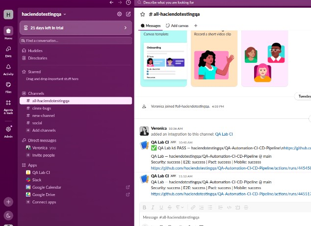
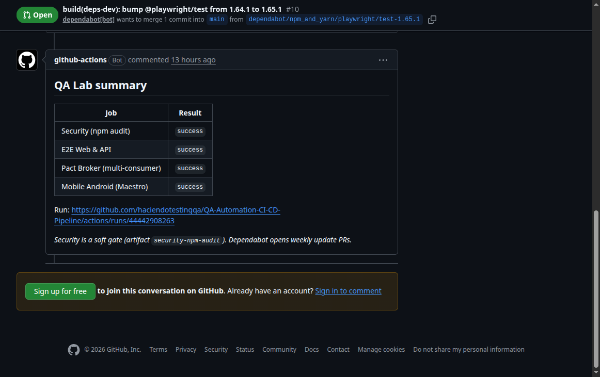

# QA Automation & CI-CD Pipeline

[](https://github.com/haciendotestingqa/QA-Automation-CI-CD-Pipeline/actions/workflows/qa-lab.yml)
[](LICENSE)
[](https://nodejs.org/)
[](https://playwright.dev)
[](https://maestro.mobile.dev)
[](https://docs.pact.io)
[](https://k6.io)

End-to-end lab that shows how a quality team can **automate tests, protect `main`, notify the team, and deliver an artifact** when quality gates are green.

**Built by** [@haciendotestingqa](https://github.com/haciendotestingqa)

**CI evidence:** [Actions](https://github.com/haciendotestingqa/QA-Automation-CI-CD-Pipeline/actions) · [example green run](https://github.com/haciendotestingqa/QA-Automation-CI-CD-Pipeline/actions/runs/44551781689)

## Table of contents

- [Overview](#overview)
- [Evidence](#evidence--slack--sticky-pr-comment)
- [Requirements](#requirements)
- [Quick start](#quick-start)
- [Project layout](#project-layout)
- [CI/CD](#cicd)
- [License](#license)

## Overview

| Layer | Tool | What it validates |
|------|------|-------------------|
| Web E2E + API | [Playwright](https://playwright.dev) | Functional / API regression against a local catalog provider |
| Mobile | [Maestro](https://maestro.mobile.dev) (Android) | Emulator user journey |
| Contracts | [Pact](https://docs.pact.io) + Broker (multi-consumer) | Web + mobile clients stay compatible with the API |
| Performance | [k6](https://k6.io) | Capacity / latency on a daily schedule (not on every push) |
| Dependency security | `npm audit` + Dependabot | Known vulnerable / outdated dependencies |
| Delivery (CD) | Docker → [GHCR](https://docs.github.com/en/packages) | Publishes the catalog API image only after CI gates pass on `main` |

> [!NOTE]
> Educational lab, not a production product. Packaging/CD is usually **Dev / DevOps** ownership; QA owns the **quality gates** and the signal (Slack / PR / artifacts).

**Notifications**

- **Slack** (Incoming Webhook): after Security, E2E, Pact, and Mobile finish, **Notify** posts a channel summary + Actions link
- **Sticky PR comment**: the same summary updates on the pull request during code review
- **Optional email** on k6 success (Gmail secrets) — GitHub does not email green checks by itself
- Secret **names** only in docs (e.g. `SLACK_WEBHOOK_URL`); values live in GitHub Actions secrets

**Pipeline flow**

```text
Push / PR → CI (security, web/API, Pact, mobile)
                ↓
         Notify → Slack (+ sticky PR comment)
                ↓
     Push to main + green gates → CD → image on GHCR
                ↓
     Daily cron (~03:17 Venezuela) → k6 → optional success email / Slack
```

**Takeaways:** CI ≠ CD · each layer answers a different question · Artifacts are the evidence · Slack closes the loop in-channel.

*One-liner:* an omnichannel QA pipeline with CI gates, GHCR delivery, dependency security, and Slack (plus optional performance email) so the team knows in near real time whether the build is ready to move forward.

## Evidence — Slack & sticky PR comment

Slack channel summary from **QA Lab CI**:



Sticky **QA Lab summary** on Dependabot PR [#10](https://github.com/haciendotestingqa/QA-Automation-CI-CD-Pipeline/pull/10):



## Requirements

- **Node.js** 18+ (LTS recommended)
- **Playwright** browsers (`npx playwright install`)
- **Maestro CLI** + Android emulator/device (for mobile)
- **k6** (for performance)
- **Docker** (optional, for Pact Broker locally / image smoke tests)

## Quick start

```bash
npm install
npx playwright install chromium
```

Maestro (Linux/macOS):

```bash
curl -Ls "https://get.maestro.mobile.dev" | bash
maestro download-samples
```

### npm scripts

| Script | Description |
|--------|-------------|
| `npm run provider:start` | Start local catalog API (`:4010`) |
| `npm run test:web` | Web E2E |
| `npm run test:api` | API tests (needs provider) |
| `npm run test:e2e` | Web + API |
| `npm run test:perf` | k6 stress test |
| `npm run test:contract` | Pact consumers + provider (file-based) |
| `npm run test:contract:broker` | Consumers → publish → verify via Broker |
| `npm run broker:up` / `broker:down` | Local Pact Broker on `:9292` |
| `npm run report` | Open Playwright HTML report |

> [!TIP]
> Start the catalog provider before API or Pact runs: `npm run provider:start` (other terminal), then `npm run test:e2e` or `npm run test:contract:broker`.

### Manual local runs

**Catalog API** (same mini-backend CI uses):

```bash
npm run provider:start
# http://127.0.0.1:4010/health
# http://127.0.0.1:4010/api/products
npm run test:api
```

**Web only** (no provider needed):

```bash
npm run test:web
```

**Mobile** (emulator on + sample APK installed):

```bash
maestro test tests/mobile/android-flow.yaml
```

**Pact with Broker** (Docker must be running):

```bash
npm run broker:up                 # http://127.0.0.1:9292
npm run provider:start            # other terminal
npm run test:contract:broker
npm run broker:down
```

Without Broker (multi-consumer, file-based):

```bash
npm run provider:start
npm run test:contract
```

## Project layout

| Path | Role |
|------|------|
| `tests/web/` | Playwright web E2E |
| `tests/api/` | Playwright API tests |
| `provider/` | Local catalog API (also Docker/CD image) |
| `tests/mobile/` | Maestro Android flow |
| `tests/performance/` | k6 stress script |
| `tests/contract/` | Pact multi-consumer + publish/verify |
| `docs/images/` | Portfolio evidence screenshots |
| `.github/workflows/qa-lab.yml` | Unified CI/CD workflow |
| `.github/dependabot.yml` | Weekly npm + Actions update PRs |

## CI/CD

Unified workflow: [`.github/workflows/qa-lab.yml`](.github/workflows/qa-lab.yml).

### Continuous Integration (quality gates)

| Job | What it does |
|-----|----------------|
| `security-audit` | `npm audit` (high+), soft gate + artifact `security-npm-audit`; Dependabot PRs weekly |
| `e2e-and-api-tests` | Playwright Web + local catalog API |
| `contract-tests` | Pact multi-consumer + Broker publish/verify |
| `mobile-tests` | Maestro on Android emulator (**API 30** in CI; local often API 33) |
| `performance-scheduled-tests` | k6 daily ~**03:17 Venezuela** (`17 7 * * *` UTC) + manual |
| `notify` | Sticky PR comment + optional Slack (`SLACK_WEBHOOK_URL`) |

Reports upload as workflow **Artifacts** (`playwright-report`, `pact-contracts`, `maestro-report`, `k6-performance-report`, `security-npm-audit`).

> [!WARNING]
> Security is a **soft gate** today (report + Dependabot). GitHub Actions **cron can delay or skip**. Do not require the k6 job as a branch-protection check — it does not run on every PR.

#### Optional Slack setup

1. Slack → Incoming Webhook for a channel  
2. Repo → **Settings → Secrets and variables → Actions → New repository secret**  
3. Name: `SLACK_WEBHOOK_URL` · Value: webhook URL  

Without the secret, Notify still comments on PRs and skips Slack cleanly.

#### Optional email on k6 success (Gmail)

| Secret | Value |
|--------|--------|
| `MAIL_TO` | Your inbox |
| `MAIL_USERNAME` | Gmail address (SMTP user) |
| `MAIL_APP_PASSWORD` | [Gmail App Password](https://myaccount.google.com/apppasswords) |

### Continuous Delivery (publish image)

On **push to `main`**, after E2E + Pact + Mobile succeed, `deliver-catalog-image` builds `provider/` and pushes to GHCR:

`ghcr.io/haciendotestingqa/qa-automation-ci-cd-pipeline/catalog-api:latest`  
(also tagged `sha-<commit>`)

CD is **skipped** on `workflow_dispatch`, PRs, and schedule (by design).

**Try the image:**

```bash
docker build -t catalog-api .
docker run --rm -p 4010:4010 catalog-api
curl -s http://127.0.0.1:4010/health
```

```bash
docker pull ghcr.io/haciendotestingqa/qa-automation-ci-cd-pipeline/catalog-api:latest
docker run --rm -p 4010:4010 ghcr.io/haciendotestingqa/qa-automation-ci-cd-pipeline/catalog-api:latest
```

If `docker pull` returns 403, set the package visibility to **Public** in GitHub Packages settings.

## License

MIT — see [LICENSE](LICENSE).
